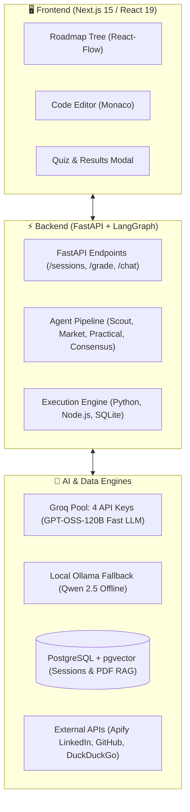
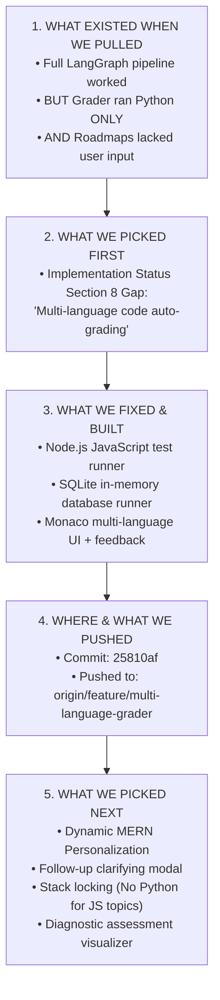
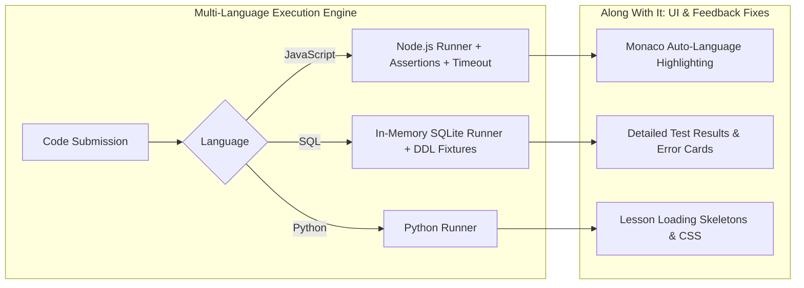
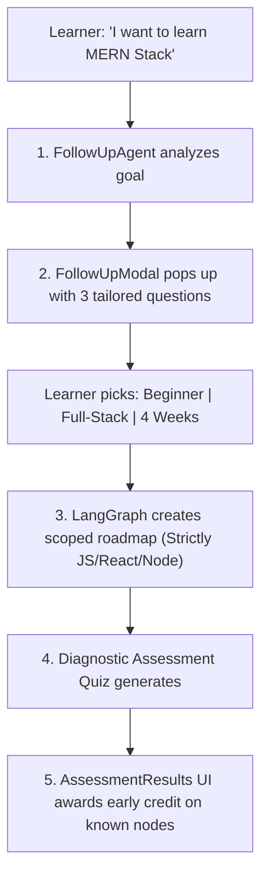

# 🧠 MindMorph — Project Handover, Architecture & Execution Journey

> **Format:** Visual, plain-English engineering KT walkthrough. No fluff, just the exact stack, the starting state, what we picked, what we fixed, what we pushed, and what we did next.

---

## 🛠️ Section 1: The Stack & Resources (What Powers the App)



### 📋 Resource Inventory Table

| Component | What Is Used | Role in Plain English |
| :--- | :--- | :--- |
| **Database** | **PostgreSQL** (`localhost:5432`) | Stores user learning roadmaps, diagnostic scores, and chat logs as JSON. |
| **Vector DB** | **pgvector** (`rag_chunks`) | Allows learners to upload PDF study notes; converts text into searchable vectors. |
| **Primary LLM** | **Groq Key Pool** (`gpt-oss-120b`) | Primary fast AI. Automatically cycles across 4 API keys so users never hit rate limits. |
| **Fallback LLM** | **Ollama** (`qwen2.5:7b` / `14b`) | Local backup model. If Groq keys expire or the internet drops, the app runs offline. |
| **Job Market API**| **Apify MCP** | Pulls real LinkedIn job requirements so roadmaps focus on real-world hiring trends. |
| **Project Code API**| **GitHub API** | Finds trending open-source repos so learners get realistic project examples. |
| **Search Engine** | **DuckDuckGo (`ddgs`)** | Free live web search for factual content grounding. |
| **PDF Embedder** | **FastEmbed (`bge-small-en`)** | Runs on CPU locally to embed uploaded user PDFs without third-party API costs. |
| **Web App** | **Next.js 15 + React 19** | Dark-mode interface, interactive graph canvas, and in-browser code editor. |
| **Backend API** | **FastAPI + Python 3.11** | Orchestrates the multi-agent AI pipeline and runs safe code execution. |

---

## 🚀 Section 2: The Journey (From Pull to Push to Next Features)



---

### 📦 Phase 1: What Existed When We Pulled
When we pulled the latest code from `upstream/main` (`tarunlnmiit/MindMorph_Learning_Platform`), the foundation was functional, but had major limitations:

#### ✅ What was already working:
1. **Multi-Agent Roadmap Generation**: Scout, Academic, Market (Apify), Practical (GitHub), and Consensus agents working in LangGraph.
2. **Dual-Path Content Generation**: Synthesizing creative drafts with live web search facts.
3. **Database & Persistence**: Sessions persisting in PostgreSQL JSONB.
4. **Provider Fallback**: Groq key rotation falling back to local Ollama.

#### ❌ The Big Gaps in the Existing Code:
1. **Python-Only Grader Bottleneck**: The backend executor only ran Python scripts. If a student wanted to learn JavaScript, React, or SQL, they were forced into written essays (`case_study`) instead of coding.
2. **No User Clarification (One-Shot Blind Generation)**: The user typed a short query (e.g. "Learn MERN"), and the AI immediately guessed their skill level, timeline, and goals without asking any questions.
3. **Python Tech Leakage**: Even when asking for JavaScript or MERN, early prerequisites often defaulted to Python programming fundamentals.
4. **Invisible Assessment Results**: Diagnostic quizzes scored answers, but gave no visual breakdown of what the student passed or skipped.

---

### 🎯 Phase 2: What We Picked First
We inspected `docs/IMPLEMENTATION_STATUS.md` (Section 8: *Personalization & Onboarding*) and chose the highest-impact blocker:

> 📌 **The Gap Picked:**
> *"Exercise language caveat: the auto-grader executes Python only... A MERN node gets a written exercise, not a Python one. A real JS/Node execution harness is future work."*

---

### 🛠️ Phase 3: What We Fixed (And What We Fixed Along With It)



1. **JavaScript / Node.js Runner (`tools/code_executor.py`)**:
   - Built a secure execution engine that writes JavaScript user code and unit assertions into a temporary script and executes via `node`.
   - Added execution timeout guards to kill accidental infinite loops safely.
2. **SQL Runner (`tools/code_executor.py`)**:
   - Built an in-memory **SQLite** engine that initializes table schemas, seeds dummy data, runs the student's query, and asserts against expected table rows.
3. **Agent & Prompt Updates**:
   - Updated `agents/exercise/format_selector_agent.py` and `exercise_synthesizer_agent.py` so they generate real JS assertions and SQL queries.
   - Updated `grader_agent.py` to parse syntax/runtime errors and translate them into clear learner guidance.
4. **Along With It (UI & Experience Fixes)**:
   - **Monaco Code Editor (`web/components/CodeEditor.tsx`)**: Configured editor language mode to dynamically switch between `javascript`, `sql`, and `python`.
   - **Test Results Feedback (`web/components/GradeResult.tsx`)**: Built structured feedback cards showing passing/failing test cases, compiler errors, and hints.
   - **Lesson Skeletons (`web/components/LessonSkeleton.tsx`, `globals.css`)**: Added smooth loading states so the page doesn't jump during generation.

---

### 🚀 Phase 4: What & Where We Pushed
Once the multi-language grading engine and tests were verified:

* **Commit Hash**: `25810af`
* **Commit Message**: `feat(exercise): implement multi-language grading harness (JS, SQL, Python)`
* **Pushed Destination**: `origin/feature/multi-language-grader` (our fork repository: `git@github.com:ATV-AMenaria/MindMorph_Learning_Platform.git`)
* **Scope**: 20 files updated (+731 additions, -137 deletions).

---

### 🌟 Phase 5: What We Picked Next (Dynamic MERN & Follow-Up System)
Immediately after pushing the multi-language grader, we addressed the next gap: **Dynamic Personalization and Stack Alignment**.



1. **Clarifying Follow-Up Questions Agent (`agents/followup/`, `prompts/followup_prompt.py`)**:
   - Created a specialized agent that analyzes any learning goal and returns 3 clarifying questions with multiple-choice options.
   - Added backend route `POST /sessions/followup`.
2. **Interactive Clarifying Pop-Up Modal (`web/components/FollowUpModal.tsx`)**:
   - Before any roadmap is built, a sleek modal asks the user their experience level, specific interest (e.g., backend vs frontend), and timeline.
3. **Strict Technology Scoping**:
   - Passed user preferences, primary language, and scope through `start_session`, LangGraph, `consensus_agent`, and `content_agent`.
   * **Result:** Asking for MERN now strictly produces **JavaScript, React, Node.js, Express, and MongoDB** modules—no random Python lessons.
4. **Diagnostic Assessment Results Visualizer (`web/components/AssessmentResults.tsx`)**:
   - When a user submits the initial diagnostic quiz, the app shows a visual breakdown of their score.
   - Topics they already know receive immediate `in_progress` credit so they aren't forced to re-learn basics.
5. **Real-Time SSE Streaming**:
   - Added real-time progress events (`Scouting...`, `Analyzing market...`, `Synthesizing...`) streaming to the UI during generation.

---

## 📌 Executive Summary

```text
1. What existed:     LangGraph roadmap + content engine worked, but Grader was Python-only and roadmaps were rigid.
2. What picked 1st:  Section 8 gap from IMPLEMENTATION_STATUS.md (Multi-language auto-grading).
3. What we fixed:    Node.js JS runner + SQLite runner + multi-language Monaco editor + test result feedback.
4. Where pushed:     origin/feature/multi-language-grader (Commit: 25810af).
5. What picked next: Clarifying Follow-Up questions, strict MERN stack alignment, and Assessment Results UI.
```
