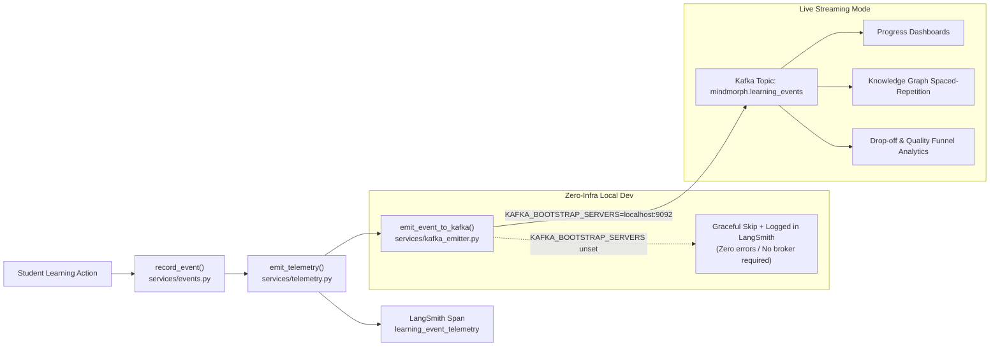

# Kafka Telemetry & Observability Architecture

**Feature:** Real-time Learning Event Streaming & LangSmith Telemetry Bridge  
**Modules:**  
- Telemetry Orchestration: [`services/telemetry.py`](file:///c:/Users/praku/OneDrive/Desktop/MindMorph_Learning_Platform/services/telemetry.py)  
- Kafka Emitter Bridge: [`services/kafka_emitter.py`](file:///c:/Users/praku/OneDrive/Desktop/MindMorph_Learning_Platform/services/kafka_emitter.py)  
- Funnel Instrumentation: [`services/events.py`](file:///c:/Users/praku/OneDrive/Desktop/MindMorph_Learning_Platform/services/events.py)  
**Status:** Implemented & Verified (October 2026)  

---

## 1. Overview

In MindMorph, learning is an active, iterative journey. Every student action produces real-time milestone events (opening a lesson, submitting a coding challenge, adapting the knowledge graph after a misconception, or mastering a prerequisite).

To enable **decoupled analytics**, **teacher progress tracking**, and **adaptive learning loops**, MindMorph pipes all journey events through a dual-mode telemetry pipeline:
1. **LangSmith Tracing:** Deep developer and LLM observability (viewable at `https://smith.langchain.com`).
2. **Apache Kafka Streaming:** High-throughput, distributed event streaming for downstream analytics, progress dashboards, and spaced-repetition schedulers.



---

## 2. Event Taxonomy & Schemas

All events are standardized under `services.events.STAGES` to prevent writer/reader key drift:

| Event Stage | Trigger | Key Fields | Purpose |
| :--- | :--- | :--- | :--- |
| `session_created` | Learner initiates a goal | `session_id`, `node_count` | Initializes session timeline & funnel tracking |
| `lesson_opened` | Learner opens a micro-unit | `node_id`, `cache_hit` | Measures engagement & time-to-first-interaction |
| `exercise_graded` | Coding/quiz test evaluated | `node_id`, `score`, `passed` | Evaluates student comprehension and difficulty calibration |
| `node_mastered` | Score ≥ 80% achieved | `node_id`, `score` | Unlocks downstream nodes in Knowledge Graph |
| `node_needs_review`| Score < 40% (remediation) | `node_id`, `score` | Triggers adaptive graph expansion with remedial nodes |
| `lesson_regenerated`| Tutor rewrites content | `node_id`, `reason` | Measures pedagogical adaptation frequency |
| `path_completed` | All target nodes mastered | `session_id`, `total_time` | Funnel completion milestone |
| `content_flagged` | Safety/quality issue raised | `node_id`, `reason` | Moderation queue & content review alert |

### Sample Kafka Event Payload:
```json
{
  "ts": "2026-10-16T09:12:34.567890+00:00",
  "stage": "exercise_graded",
  "session_id": "user@example.com:python-concurrency",
  "node_id": "asyncio-event-loops",
  "score": 92.5,
  "passed": true
}
```

---

## 3. Resilience & Zero-Infra Dev Mode

The telemetry bridge is designed to **never interrupt a student's learning session**:

- **No Hard Dependency:** If `KAFKA_BOOTSTRAP_SERVERS` is not present in `.env`, the emitter automatically logs a `"skipped"` status inside the LangSmith trace and returns in `< 1ms`.
- **Fault-Tolerant:** If the Kafka broker goes offline or network packets drop during a session, the error is caught, logged at WARNING level, and recorded as `"status": "error"` in LangSmith without crashing the FastAPI backend.
- **Partition Key Routing:** Events automatically partition by `session_id` (or `node_id`), guaranteeing in-order event delivery per learner.

---

## 4. Configuration

Configure Kafka behavior in your `.env` file:

| Environment Variable | Default | Description |
| :--- | :--- | :--- |
| `KAFKA_BOOTSTRAP_SERVERS` | *unset* | Comma-separated list of Kafka brokers (e.g., `localhost:9092` or Confluent Cloud endpoint). Unset disables Kafka emission without errors. |
| `MINDMORPH_KAFKA_TOPIC` | `mindmorph.learning_events` | Kafka topic name for all learning events. |
| `LANGCHAIN_TRACING_V2` | `true` | Enables real-time LangSmith tracing for both Laya and Kafka telemetry. |
| `LANGCHAIN_PROJECT` | `MindMorph_Local` | Target LangSmith project workspace. |

---

## 5. Monitoring Telemetry

### A. In LangSmith
1. Navigate to **[smith.langchain.com](https://smith.langchain.com/)** -> Project **`MindMorph_Local`**.
2. Filter runs by `name:learning_event_telemetry` or `name:kafka_event_emitter`.
3. Inspect the run metadata: topic name, partition key, and delivery status.

### B. In Kafka CLI (When Running Locally)
To inspect the live stream directly from your terminal:
```bash
# Terminal 1: Consume events in real time
kafka-console-consumer.sh --bootstrap-server localhost:9092 --topic mindmorph.learning_events --from-beginning

# Or with python:
python -c "from kafka import KafkaConsumer; c = KafkaConsumer('mindmorph.learning_events', bootstrap_servers='localhost:9092'); print('Listening...'); [print(m.value.decode('utf-8')) for m in c]"
```

### C. Optional Docker Compose Service
To spin up Kafka and a web-based Kafka-UI dashboard alongside Postgres:
```yaml
services:
  zookeeper:
    image: confluentinc/cp-zookeeper:7.5.0
    environment:
      ZOOKEEPER_CLIENT_PORT: 2181

  kafka:
    image: confluentinc/cp-kafka:7.5.0
    depends_on: [zookeeper]
    ports: ["9092:9092"]
    environment:
      KAFKA_BROKER_ID: 1
      KAFKA_ZOOKEEPER_CONNECT: zookeeper:2181
      KAFKA_ADVERTISED_LISTENERS: PLAINTEXT://localhost:9092
      KAFKA_OFFSETS_TOPIC_REPLICATION_FACTOR: 1

  kafka-ui:
    image: provectuslabs/kafka-ui:latest
    ports: ["8080:8080"]
    environment:
      KAFKA_CLUSTERS_0_NAME: local
      KAFKA_CLUSTERS_0_BOOTSTRAPSERVERS: kafka:9092
```

---

## 6. Automated Testing

The telemetry bridge and Kafka emitter are thoroughly tested:

```bash
conda activate mm
pytest tests/test_kafka_emitter.py tests/test_events.py -v
```

All tests verify:
- Graceful skipping when Kafka is unset.
- Correct topic routing and key partitioning when configured.
- Safe handling of network/broker errors.
- End-to-end integration with `services.events.record_event`.
